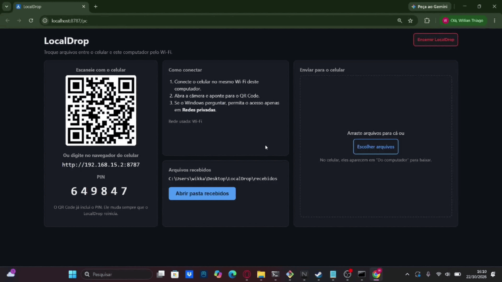
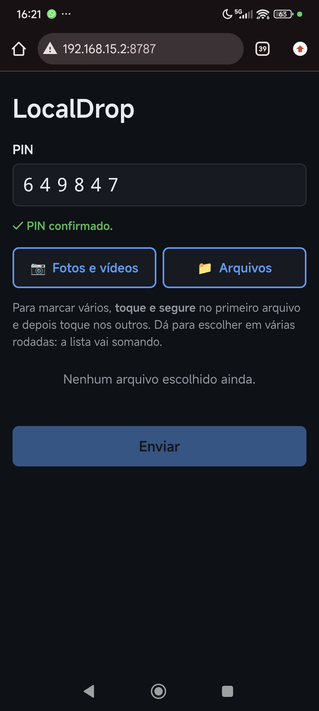

# LocalDrop

Troque arquivos entre o celular Android e o PC Windows pelo Wi-Fi de casa, nos dois sentidos.
Sem nuvem, sem cabo, sem conta e sem instalar app no celular.

<p align="center"></p>

## Demonstração

<table>
  <tr>
    <th>Tela do PC</th>
    <th>Celular</th>
  </tr>
  <tr>
    <td></td>
    <td></td>
  </tr>
</table>

## Como funciona

1. Dois cliques no atalho **LocalDrop** da Área de Trabalho.
2. O navegador do PC abre com um **QR Code** e um **PIN** de 6 dígitos.
3. Você aponta a câmera do celular para o QR Code (os dois no mesmo Wi-Fi).
4. Escolhe fotos, vídeos ou documentos e toca em **Enviar**.
5. Acompanha o progresso, a velocidade e o tempo restante.
6. Os arquivos aparecem na pasta `recebidos/` (botão **Abrir pasta recebidos** na tela do PC).

**Do PC para o celular:** arraste arquivos para **Enviar para o celular** na tela do PC. No
celular, eles aparecem em **Do computador**; toque em **Baixar** e o arquivo vai para a pasta
Downloads.

**Para fechar:** feche a aba do LocalDrop no PC (ele encerra sozinho em alguns segundos) ou use o
botão **Encerrar LocalDrop**.

Nada passa pela internet: o celular fala direto com o PC dentro da sua rede.

## Arquivos aceitos

| Categoria   | Extensões                         | Limite padrão |
|-------------|-----------------------------------|---------------|
| Imagens     | jpg, jpeg, png, webp, gif         | 50 MB         |
| Documentos  | pdf, docx, xlsx, pptx, txt, csv   | 50 MB         |
| Áudio       | mp3, m4a                          | 200 MB        |
| Vídeo       | mp4                               | 4 GB          |
| Compactados | zip                               | 2 GB          |

O **conteúdo** de cada arquivo é conferido, não só a extensão. Executáveis, scripts e documentos
do Office com macro são recusados.

## Requisitos

- Windows 10 ou 11
- [Node.js](https://nodejs.org/) 22 ou mais recente (versão LTS)
- PC e celular no **mesmo Wi-Fi**, com a rede marcada como **Privada** no Windows
- Celular Android com Chrome (ou outro navegador atual)

## Instalação (uma vez)

```bash
git clone https://github.com/WillianJunges/LocalDrop.git
cd LocalDrop
npm install
npm run atalho
```

O `npm run atalho` cria o atalho **LocalDrop** na Área de Trabalho (rode de novo depois de
atualizar o projeto, para pegar ajustes do atalho). A partir daí, não é preciso
abrir o terminal: o atalho instala dependências e compila sozinho quando o código muda.

Na primeira vez, o Firewall do Windows pergunta se o Node.js pode acessar a rede.
Marque **apenas "Redes privadas"**. Não é preciso, nem recomendado, desativar o firewall.

## Uso

- **Abrir:** dois cliques no atalho. O navegador abre a tela do PC; uma janela de terminal fica
  minimizada na barra de tarefas. Se o LocalDrop já estiver aberto, o atalho só abre o navegador.
- **Fechar:** feche a aba do LocalDrop no navegador, ou clique em **Encerrar LocalDrop**. Ninguém
  precisa mexer no terminal. Detalhes:
  - ao fechar a aba, ele espera 15 segundos (para não fechar num simples F5) e encerra;
  - com duas abas abertas, só encerra quando as duas fecharem;
  - **nunca encerra no meio de um envio ou download**: espera terminar;
  - se o navegador for fechado à força, encerra depois de 3 minutos sem sinal.
- **Enviar do PC para o celular:** arraste arquivos para **Enviar para o celular** (ou use
  **Escolher arquivos**). No celular, toque em **Baixar** em **Do computador**. A tela do PC mostra
  quando o celular baixou. Os arquivos ficam disponíveis até você tirá-los da lista ou fechar o
  LocalDrop; valem a mesma lista de tipos e os mesmos limites.
- **No celular:** escaneie o QR Code. O PIN já vem junto; se pedir, digite o que está na tela do PC.
- **Vários arquivos:** use **Fotos e vídeos** (abre a galeria) ou **Arquivos**. Para marcar vários,
  toque e segure no primeiro. Dá para escolher em várias rodadas.
- **Envios longos:** mantenha a tela do celular ligada e a página aberta.

O PIN muda toda vez que o LocalDrop abre.

## Configuração (opcional)

Copie `localdrop.exemplo.json` para `localdrop.json` e altere o que quiser:

```json
{
  "porta": 8787,
  "pasta": "recebidos",
  "limitesMB": { "video": 8192 }
}
```

| Opção       | Padrão       | Descrição                                                                   |
|-------------|--------------|-----------------------------------------------------------------------------|
| `porta`     | `8787`       | Porta do servidor                                                           |
| `pasta`     | `recebidos`  | Onde os arquivos são salvos (relativa ao projeto ou absoluta)               |
| `limitesMB` | tabela acima | Limite por categoria: `imagem`, `documento`, `audio`, `video`, `compactado` |

Erros no arquivo (opção com nome errado, valor inválido) impedem o LocalDrop de abrir e mostram o
motivo no terminal. As variáveis de ambiente `LOCALDROP_PORTA` e `LOCALDROP_DIR` têm prioridade
sobre o arquivo. O `localdrop.json` não vai para o Git.

## Problemas comuns

| Sintoma | O que fazer |
|---|---|
| O celular não abre a página | Confira se os dois estão no mesmo Wi-Fi e se a rede do Windows está como **Privada** (Configurações → Rede e Internet → Wi-Fi → propriedades da rede). Confira se o firewall foi liberado para redes privadas. |
| Funciona em casa, mas não em outro lugar | Redes de hotel, faculdade ou "convidados" costumam ter **isolamento de clientes**, que impede um aparelho de falar com o outro. Não há o que fazer pelo LocalDrop. |
| Endereço com IP errado | O terminal lista os IPs ignorados e o motivo. VPNs e adaptadores virtuais (WSL, VirtualBox, Hyper-V) são descartados de propósito. Desligar a VPN costuma resolver. |
| "A porta 8787 já está em uso por outro programa" | Feche o outro programa ou troque a `porta` no `localdrop.json`. |
| O LocalDrop fechou sozinho | Ele encerra quando a tela do PC fica fechada. Abra de novo pelo atalho. |
| "PIN incorreto" | O PIN muda a cada abertura. Escaneie o QR Code de novo. Após 5 erros, o celular fica bloqueado por 5 minutos. |
| O envio parou no meio | O celular pode ter bloqueado a tela ou perdido o Wi-Fi. Toque em **Tentar de novo**: só os que faltaram são reenviados. |
| "Node.js não encontrado" ao abrir o atalho | Instale o Node.js LTS e abra o atalho de novo. |
| Arquivo recusado | A tela mostra o motivo: tipo não permitido, acima do limite ou conteúdo que não bate com a extensão. |

## Segurança

O LocalDrop fica acessível para outros aparelhos da mesma rede, então foi feito com cuidado:

- PIN por sessão, com bloqueio após 5 tentativas erradas.
- A tela do PIN só abre no próprio PC (checagem de IP e do header `Host`, contra DNS rebinding).
- Conteúdo de cada arquivo validado; docx/xlsx/pptx com macro recusados; zip nunca extraído.
- Nomes de arquivo sanitizados (sem path traversal) e nunca sobrescritos.
- Arquivos recebidos marcados como "baixados da internet" pelo Windows.
- Cabeçalhos de segurança (CSP, anti-iframe) e proteção contra CSRF.
- Do PC para o celular: só os arquivos que você escolheu, numa pasta temporária apagada ao fechar;
  a lista exige o PIN e cada link tem um código único e impossível de adivinhar.

**Limitação importante:** a conexão é **HTTP, sem criptografia**. Na mesma rede, alguém com as
ferramentas certas poderia ver o tráfego, inclusive os arquivos e o PIN. Use em redes em que
você confia, como a da sua casa. Detalhes em [docs/DECISOES.md](docs/DECISOES.md).

## Desenvolvimento

| Comando             | O que faz                                                           |
|---------------------|---------------------------------------------------------------------|
| `npm run dev`       | Servidor + Vite com recarregamento automático (só no PC)            |
| `npm run build`     | Compila front e back                                                |
| `npm start`         | Roda a versão compilada (é a que o celular acessa)                  |
| `npm run iniciar`   | O mesmo que o atalho: instala/compila se preciso e abre o navegador |
| `npm test`          | Testes automatizados (servidor e front)                             |
| `npm run typecheck` | Verificação de tipos                                                |
| `npm run atalho`    | Cria o atalho na Área de Trabalho                                   |
| `npm run icone`     | Regera `scripts/localdrop.ico` a partir do desenho                  |

Em `npm run dev`, abra `http://localhost:5173/pc`. O modo dev não fica acessível pela rede; para
testar no celular, use `npm run iniciar`.

Checklist de teste manual: [docs/CHECKLIST.md](docs/CHECKLIST.md).

```
client/   React + Vite (tela do PC e página do celular)
server/   Node.js + Express (API, upload, validação)
scripts/  Atalho, inicializador e ícone
docs/     Decisões técnicas, diário do projeto e checklist
```

## Stack

Node.js · TypeScript · Express · React · Vite · Vitest · busboy · yauzl

## Como foi feito

Projeto pessoal construído em 5 fases com o Claude Code, documentado em
[docs/DIARIO.md](docs/DIARIO.md).
